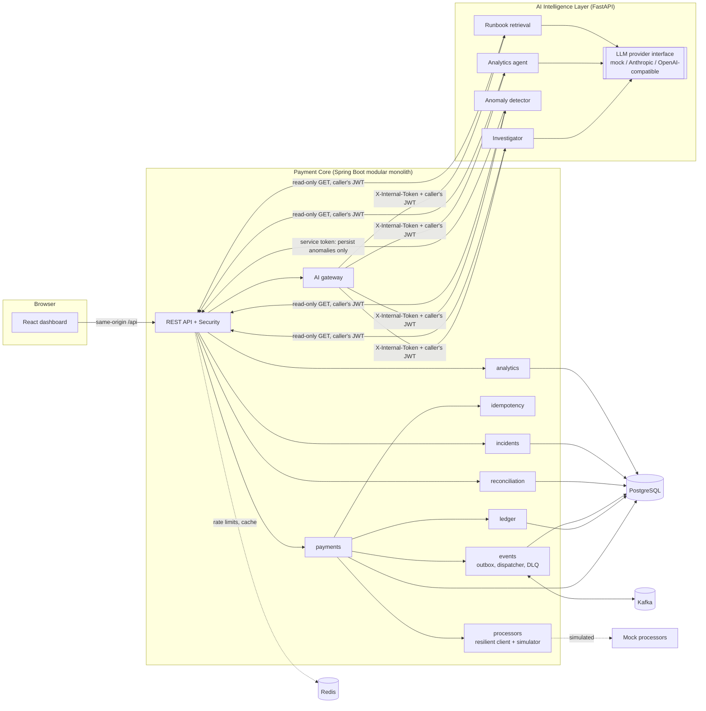
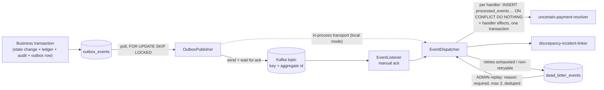

# Architecture

PaySense is a **modular monolith** (Kotlin / Spring Boot) plus a small, independent **AI intelligence service** (Python / FastAPI) and a **React dashboard**. All payments are simulated; no real money, card data or banking network is involved.



## Responsibilities

| Component | Responsibility | Notes |
|---|---|---|
| `payments` | Payment aggregate, the single state machine, authorize/capture/refund orchestration, callbacks, stuck-payment recovery | One place defines legal transitions (`PaymentStateMachine`) |
| `processors` | `PaymentProcessor` interface, `MockPaymentProcessor`, simulation controls, `ResilientProcessorClient` (deadline, retry+jitter, circuit breaker per processor, bulkhead) | Simulation is a dev-only bean; absent in production configuration |
| `idempotency` | Durable API idempotency keyed by `(principal, key)` | PostgreSQL unique constraint is the source of truth |
| `ledger` | Immutable double-entry postings per capture/refund | DB triggers enforce balance and immutability |
| `events` | Transactional outbox, publisher, `EventDispatcher` (dedupe, retry, DLQ), Kafka listener, replay | At-least-once; handlers are idempotent |
| `reconciliation` | Synthetic settlement reports, matching engine, discrepancy lifecycle | Reports and acknowledges; never edits financial records |
| `analytics` | Parameterised aggregate queries, time series for anomaly detection | The only numbers the AI layer may use |
| `incidents` | Incidents, anomaly correlation, timelines | Auto-opened from anomalies and reconciliation findings |
| `ai` | Gateway to the AI service, investigation history | AI is optional; failures degrade, never block |
| `security` | JWT auth, roles, service token, rate limits | Stateless; CSRF not applicable to bearer-token APIs |
| `observability` | Micrometer metrics, operational log store, correlation ids | Low-cardinality labels only |
| AI service | Investigation, NL analytics, incident summaries, anomaly detection, runbook Q&A | **Read-only by construction** |

Package boundaries inside the monolith follow the dependency direction `api → service → repository`; modules talk through explicit interfaces (`PaymentProcessor`, `ProcessorCallbackSink`, `EventHandler`, `LLMProvider`). The `transactions` concern of the original brief is covered by the explicit `TransactionTemplate` boundaries in `payments` (see below) and by the audit/ledger tables, so there is no empty package for it.

## Request flow: authorize a payment

No database transaction or row lock is held while the processor is called.

```mermaid
sequenceDiagram
    participant C as Client
    participant A as API (controller)
    participant I as IdempotentExecutor
    participant S as PaymentOperationService
    participant DB as PostgreSQL
    participant P as ResilientProcessorClient → processor
    C->>A: POST /payments/{id}/authorize (Idempotency-Key)
    A->>I: twoPhase(principal, key, fingerprint)
    I->>DB: INSERT idempotency record IN_PROGRESS (committed)
    I->>S: run
    S->>DB: TX1: lock payment row, CREATED→PROCESSING, insert attempt, audit event
    S->>P: execute(requestId = paymentId:AUTHORIZE:n)  [deadline, retry on provable non-execution, breaker]
    P-->>S: APPROVED / DECLINED / timeout (ambiguous) / unavailable (not executed)
    S->>DB: TX2: lock row, record attempt, apply outcome: state + ledger + audit + OUTBOX event (one commit)
    S-->>I: result
    I->>DB: mark idempotency record COMPLETED with the response
    I-->>C: 200 / 202 (uncertain) / 503 (not executed; key released)
```

Outcome mapping (one table drives it, `PaymentOutcomeApplier`):

| Processor result | Authorize | Capture | Refund |
|---|---|---|---|
| Approved | AUTHORIZED | CAPTURED (+ledger) | REFUNDED (+reversal) |
| Declined / invalid | FAILED | back to AUTHORIZED | back to CAPTURED |
| Provably not executed (unavailable, circuit open) | back to CREATED | back to AUTHORIZED | back to CAPTURED |
| Timeout / unknown error | **UNCERTAIN** | **UNCERTAIN** | **UNCERTAIN** |

`UNCERTAIN` is a first-class state. No new operation is accepted while a payment is uncertain; resolution is a **read-only lookup** of the original processor request id (never a re-send).

## Event flow and the outbox pattern



* The outbox row is written **in the same database transaction** as the business change. Either both exist or neither does.
* The publisher marks a row `PUBLISHED` only after the broker acknowledged it. A crash between "acked" and "marked" re-sends the event; consumers deduplicate.
* Failed publication backs off exponentially with jitter (`next_attempt_at`); after `max-attempts` the row is `FAILED` and an ADMIN can requeue it. Later events of an aggregate wait behind an earlier one that is backing off.
* Each consumer deduplicates durably by `(consumer, event_id)` in `processed_events`. For database-only handlers the marker and the effects commit atomically. The resolver calls the processor, so it runs outside the dedupe transaction and is itself idempotent (it only acts on `UNCERTAIN` payments).
* The Kafka offset is acknowledged only after the dispatcher returned: every handler processed the event, saw a duplicate, or the event was durably dead-lettered. If even the dead-letter write fails (database down), the record is not acknowledged and is redelivered.
* **Local mode:** `PAYSENSE_EVENTS_TRANSPORT=in-process` skips the broker but keeps the outbox, dedupe, retry and DLQ code paths identical. Integration tests exercise the real broker (embedded KRaft Kafka).

Guarantees and limits are spelled out in [failure-scenarios.md](failure-scenarios.md). In short: at-least-once delivery with idempotent handlers; **not** exactly-once end to end.

## Idempotency: three different mechanisms

| Layer | Problem | Mechanism |
|---|---|---|
| **API idempotency** | Client retries `POST /payments` after a network error | `Idempotency-Key` + request fingerprint stored in `idempotency_records` under `UNIQUE(principal, key)`; replay returns the stored response |
| **Processor idempotency** | A retried call must not charge twice | Stable `processorRequestId = paymentId:OPERATION:attempt`; the (simulated) processor stores results under `UNIQUE(processor, request_id)` and replays them |
| **Consumer idempotency** | Kafka redelivers events | `processed_events` `PRIMARY KEY(consumer, event_id)` written with the handler's effects |

## AI investigation flow

```mermaid
sequenceDiagram
    participant U as Investigator (browser)
    participant B as Backend
    participant AI as AI service
    participant L as LLM provider
    U->>B: POST /api/v1/ai/investigations {payment, question}
    B->>B: authenticate, check role (INVESTIGATOR), verify subject exists, store RUNNING
    B->>AI: POST /v1/investigations (X-Internal-Token + the caller's JWT)
    AI->>B: GET payment, events, attempts, logs, discrepancies, metrics (allow-listed paths, caller's JWT)
    AI->>AI: mint evidence ids, clean untrusted text, withhold instruction-like text, redact secrets, budget size
    AI->>L: prompt (instructions in system prompt; evidence as tagged JSON data)
    L-->>AI: JSON
    AI->>AI: strict schema, citations must exist, no action claims, identifiers must be grounded
    AI-->>B: facts (verified) + findings (rules) + analysis (validated AI) or degraded result
    B->>B: persist result + provider/model/tokens/latency (30-day retention)
    B-->>U: 201 with status COMPLETED | DEGRADED | UNAVAILABLE
```

Details of tools, permissions and defences are in [ai-design.md](ai-design.md).

## Transaction boundaries

| Operation | Boundary |
|---|---|
| Create payment | One transaction: payment, audit event, outbox row, idempotency record |
| Authorize / capture / refund | TX1 (begin) · processor call (no tx) · TX2 (result: state, ledger, audit, outbox) · idempotency completion |
| Callback | One transaction: callback dedupe row, audit, state change if applicable |
| Reconciliation run | Run row committed first; matching + discrepancies + outbox events in one transaction; failure marks the run `FAILED` |
| Event handling | One `REQUIRES_NEW` transaction per handler per attempt (dedupe row + effects) |

## Deployment view

`docker-compose.yml` runs PostgreSQL, Redis, Kafka (KRaft), backend, AI service, frontend (nginx reverse proxy) and, with the `observability` profile, Prometheus and Grafana. The browser only talks to nginx; API keys live only in the AI service's environment. See the README for commands.
