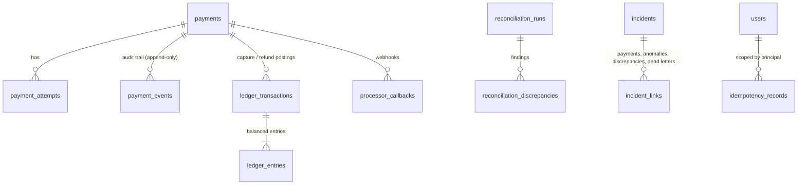

# Data model

PostgreSQL is the system of record. **Flyway migrations are the source of truth** (`backend/src/main/resources/db/migration`); Hibernate runs with `ddl-auto=validate` and fails startup if the entities drift from the schema. All timestamps are `timestamptz`, written and returned as UTC (ISO 8601 in the API). Money is `numeric(19,4)` plus a 3-letter currency; no floating point anywhere in the money path (`BigDecimal` / `numeric`).

## Tables

| Table | Purpose | Key constraints and indexes |
|---|---|---|
| `users` | Development identities (bcrypt hashes) with a role check (`VIEWER`/`INVESTIGATOR`/`ADMIN`) | `UNIQUE(username)` |
| `payments` | Payment aggregate; `version` for optimistic locking, `pending_operation` for in-flight/uncertain work | `CHECK(amount > 0)`, status `CHECK`; indexes on `(created_at)`, `(status, created_at)`, `(merchant_id, created_at)`, `(processor, created_at)`, `(correlation_id)`; partial indexes for in-flight and `UNCERTAIN` rows (the recovery sweeper reads only those); V6: trigram GIN on `lower(coalesce(description,''))` and `lower(merchant_id)` for free-text search |
| `payment_attempts` | One row per processor interaction with request id, response code, failure category, response time | `UNIQUE(payment_id, operation, attempt_number)`; `(processor, started_at)` for analytics |
| `payment_events` | **Append-only** audit trail with source, actor, correlation id, metadata | `UNIQUE(payment_id, sequence)`; `BEFORE UPDATE OR DELETE` trigger raises |
| `idempotency_records` | API idempotency | **`UNIQUE(principal, idempotency_key)`**; fingerprint, status, stored response; `expires_at` index for retention |
| `ledger_transactions` | One posting per payment and operation | **`UNIQUE(payment_id, operation)`** (duplicate-posting guard), `UNIQUE(id, currency)`, refund must reference the capture it reverses |
| `ledger_entries` | Debit/credit lines | FK `(transaction_id, currency)` forces entry currency = transaction currency; deferred constraint trigger requires debits = credits and at least two entries; immutable |
| `outbox_events` | Transactional outbox | partial index on `PENDING` rows by `created_at`; `status`, `attempts`, `next_attempt_at`, `last_error` |
| `processed_events` | Consumer dedupe | `PRIMARY KEY(consumer, event_id)` |
| `dead_letter_events` | Events that could not be processed | partial `UNIQUE(consumer, event_id)`; `replay_count`, `replayed_by`, `replay_reason` |
| `mock_processor_transactions` | The simulated processor's own memory (also the source of synthetic settlement reports) | `UNIQUE(processor, request_id)` = processor-level idempotency |
| `processor_callbacks` | Webhook dedupe | `UNIQUE(processor, callback_id)` |
| `processor_settlement_records` | Lines of generated settlement reports | `UNIQUE(report_id, line_number)`; deliberately **no** uniqueness on the processor transaction id so duplicate lines are detectable |
| `reconciliation_runs` / `reconciliation_discrepancies` | Runs and findings | `UNIQUE(run_id, type, payment_reference, operation)` |
| `incidents` / `incident_links` | Incidents and what they group | `incident_links` PK `(incident_id, link_type, ref_id)` |
| `anomaly_events` | Detector output with observed, baseline, threshold, score, severity, sample size | `UNIQUE(metric, dimension, window_start, window_end)` makes re-detection idempotent |
| `ai_investigations` | AI interaction metadata and the validated result | `expires_at` (retention) |
| `operational_logs` | Curated log lines (processor errors, retries, breaker transitions, DLQ) that investigations can cite by id | partial indexes on `payment_id`, `correlation_id` |
| `runbook_documents` | Versioned runbooks and past incident reports with full-text search | `UNIQUE(doc_key, version)`; GIN on a trigger-maintained `tsvector` |

## Design decisions

* **Constraints enforce invariants, code only reports them.** Duplicate payments per key, duplicate ledger postings, unbalanced ledger transactions, duplicate event processing and duplicate discrepancies are all impossible at the database level, so a bug or a race cannot violate them silently.
* **Append-only is enforced with triggers.** `payment_events`, `ledger_transactions` and `ledger_entries` reject `UPDATE` and `DELETE`. `TRUNCATE` (used by tests and the development reset) is not blocked. Corrections are **reversals** (a refund posts the exact opposite entries and references the original transaction); history is never edited.
* **Ledger scope.** Authorization is a hold and produces no posting. Capture debits `PROCESSOR_RECEIVABLE` and credits `MERCHANT_PAYABLE`; refund is the exact reverse. Balances are tracked per currency and never summed across currencies. This is a deliberately small, simulated ledger, **not** a certified accounting system (no fees, FX, chart of accounts or period close).
* **Pessimistic row lock for mutations.** `SELECT ... FOR UPDATE` on the payment serializes authorize/capture/refund/callback/recovery for one payment; the `@Version` column is a second line of defence.
* **Bounded reads.** Every list endpoint is paginated (page size ≤ 100), sort fields are allow-listed, analytics windows are capped at 31 days, and bucket counts are bounded. Nothing loads an unbounded history into memory.
* **Index rationale.** The partial indexes keep the recovery sweeper and the uncertain-payment views cheap regardless of table size; `(status, created_at)` serves the filtered list; trigram indexes (V6) serve the free-text search. [performance.md](performance.md) records the measured effect of the trigram indexes.

## Retention

| Data | Retention | Mechanism |
|---|---|---|
| Idempotency records | 24 h (`idempotency-ttl`) | job every 15 minutes (`BackgroundJobs.retention`) deletes `expires_at < now` |
| Published outbox rows | 7 days | same job |
| Operational logs | 7 days | same job |
| `processed_events` | 14 days (must exceed the longest possible redelivery window) | same job |
| AI investigations | 30 days (`expires_at`) | same job |
| Payments, events, ledger, reconciliation, incidents | kept (the audit trail is the product) | none; production would archive by partition |
